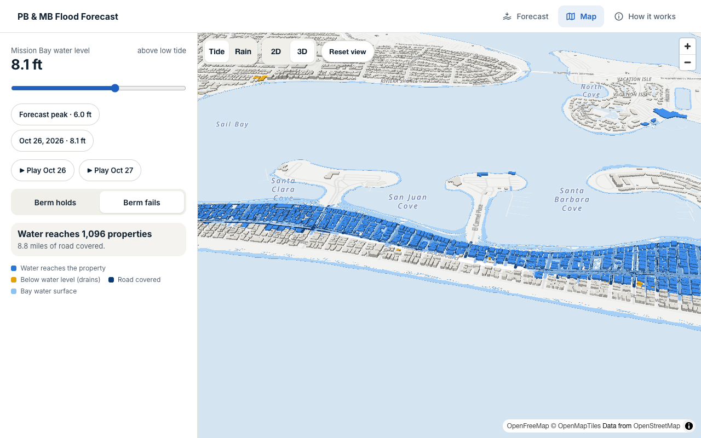
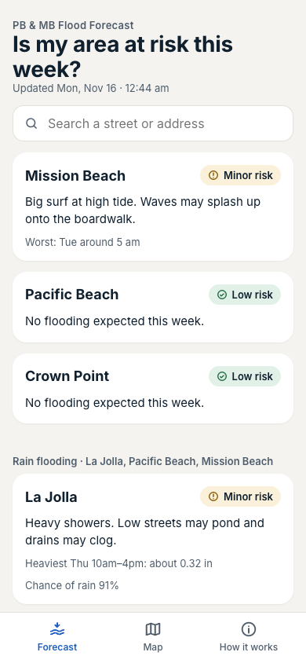
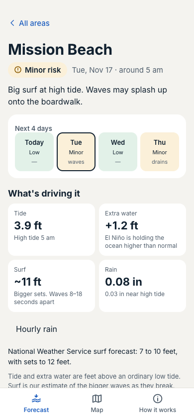
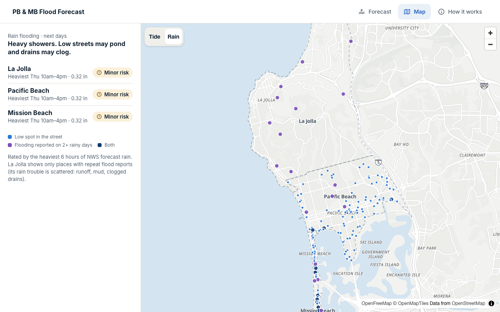

# PB & MB Flood Forecast

**Street-by-street flood forecasts for Pacific Beach, Mission Beach and La Jolla (San Diego) during the 2026–27
El Niño winter, checked against real floods.**

**Live site:** https://pb-mb-flood-forecast.vercel.app (updated twice a day)



*Above: Mission Bay at 8.1 ft, the Oct 26, 2026 peak, with the bay-side sand berm failed. The model puts water at
1,096 properties and over 8.8 miles of road. That day the berm broke and bay water flooded Mission Beach yards and homes.*

| Home: "Is my area at risk this week?" | Area detail | Rain flooding map |
|---|---|---|
|  |  |  |

## Why
In fall 2026, a Kelvin wave and El Niño raised local sea level by more than a foot. On **Oct 27, 2026** the
San Diego tide gauge logged its highest hour on record, and Mission Bay water broke through the sand berm into
Mission Beach. Long-term sea-level-rise maps don't answer the question people actually have:
**is my street at risk this week, and when?** This project answers it, and keeps score.

## How it works
**Water height = predicted tide + extra water + wave run-up**, compared with the ground, for every street and building.

| Piece | Data | Method |
|---|---|---|
| Predicted tide | NOAA CO-OPS (La Jolla 9410230, San Diego 9410170, Mission Bay 9410196) | NOAA harmonic predictions |
| Extra water (El Niño, storms) | Same gauges, measured minus predicted | 25-hour average, held for the forecast |
| Wave run-up (ocean side) | Scripps CDIP MOP nearshore wave forecasts (two models) | Stockdon (2006) R2% with beach slope + crest from lidar, every ~100 m |
| Ground | USGS 3DEP 2024 lidar, 1 m | "Connected" flood fill: water only reaches low spots it can flow to |
| Bay-side sand berm | News + City reports | Up Oct–Apr (hand-kept file); may leak at 7.8 ft+; "if the berm fails" rating |
| Rain | NWS hourly forecast per neighborhood; airport gauge since 2000 | Heaviest 6 h → rating; ponding spots from lidar; City flood reports |

A **Python pipeline** (`pipeline/`) does the heavy computation and writes static files. The **website** (`web/`, React +
MapLibre GL, with 3D buildings and a rising water surface) only displays them, so it stays fast. A **GitHub Actions bot**
saves every forecast twice a day *before* the event (`forecast_log/`) so each one can be scored afterward, with no hindsight.

## How good is it?
**Track record (scored against news, NWS storm reports and eyewitness photos, 18 days):** 9 right, 3 close, 6 missed.
Every miss is listed on the site's *How it works* page and in [`docs/evidence/`](docs/evidence/). The main lessons:
- **The berm is the biggest unknown.** There's no berm in summer (Jul 14 and Aug 11, 2026 flooded while the model
  assumed one), and it leaked at about 7.9 ft. Both are now built into the ratings, and the "if the berm fails"
  rating was right every time.
- **The ocean side under-predicts.** When run-up comes within about 2 ft of the boardwalk top, water is already
  on the boardwalk (Nov 14, 2026, verified in person).
- **Wave forecasts:** in a twice-daily check against the CDIP nowcast, the ECMWF-driven model averages about 103% of
  actual wave height and the NOAA-driven one about 70%. The site uses the higher of the two.
- **Rain spots:** City "street flooded" reports on rainy days land at our Pacific Beach ponding spots **3.6× more often
  than chance** (dry-day reports, used as a control, don't cluster there). In La Jolla the ground map does no better
  than chance (hillside runoff, mud and clogged drains), so La Jolla shows only places with repeat reports.

Full write-up: [`docs/WRITEUP.md`](docs/WRITEUP.md)

## How it differs from existing maps
- **USGS CoSMoS** and **NOAA's Sea Level Rise Viewer** show long-term scenarios (e.g. +1 ft of sea level, a 100-year storm).
  This is a **3-day operational forecast**, driven by today's tide, today's extra water and the wave forecast.
- **NWS coastal flood advisories** cover whole coastal zones. This works **street by street**, models the
  **bay-side berm** and **rain**, and **publishes its own track record**.

## Run it yourself
```bash
python3 -m venv .venv && source .venv/bin/activate && pip install -r requirements.txt
python pipeline/forecast_logger.py      # save a forecast snapshot (what the bot does twice a day)
python pipeline/build_site_data.py      # turn the latest snapshot into web/public/data/*.json
cd web && npm install && npm run dev    # http://localhost:5173
```
The one-time ground and flood steps (lidar download, flood model, danger heights, rain analysis) are listed with
their sources and dates in [`docs/DATA_SOURCES.md`](docs/DATA_SOURCES.md). Each script's docstring says what it reads and writes.

## Limits
Not an official warning: see the [National Weather Service](https://www.weather.gov/sgx/). The map says "water
reaches this property," never "this house floods," because floor heights are unknown. Storm drains, the berm's real
height and drain capacity aren't public. Bay water spreads instantly in the model. Beaches change shape after
the Nov 2024 lidar.

## Data credits
NOAA CO-OPS · Scripps Institution of Oceanography CDIP · USGS 3DEP lidar (2024, gaps filled from 2014) · National Weather
Service (forecasts, alerts, storm reports via Iowa Environmental Mesonet) · City of San Diego open data (Get It Done,
community planning areas) · © OpenStreetMap contributors (ODbL) · OpenFreeMap basemap.

---
Built by Brandon Sosa (SDSU Computer Science) · [github.com/BrandonSosa3](https://github.com/BrandonSosa3) · Code: MIT license ([LICENSE](LICENSE)); data keeps its sources' terms.
