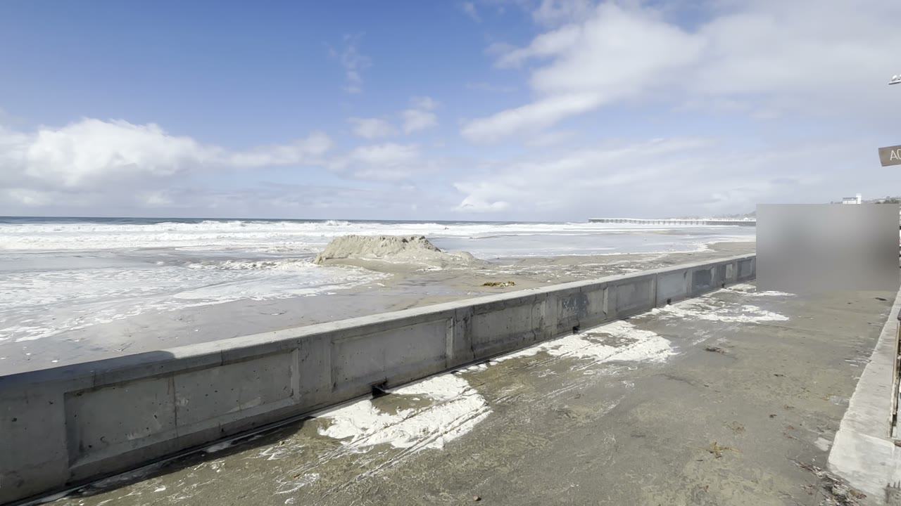
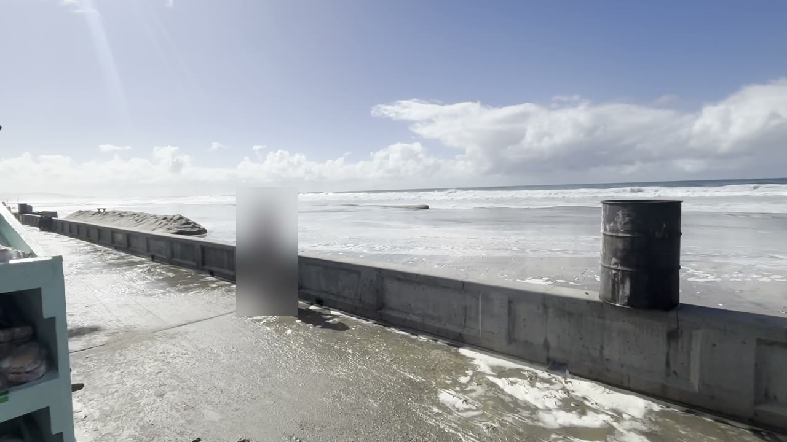
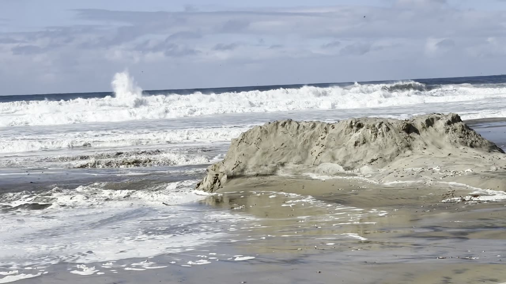

# Prediction: Sat Nov 14, 2026 (ocean side, wave run-up)

**Written before the event** (committed Fri Nov 13, 2026 evening, Pacific time; git timestamp is the proof).
Inputs are the frozen forecast snapshot `forecast_log/2026/11/2026-11-13T2241Z` (saved by the logger at
2:41 pm PST Fri), so nothing here uses information from after that time.

## Conditions forecast
- High tide ~10:42 am. Still water (tide + extra water) at La Jolla: **6.34 ft MLLW** peak
  (extra water +1.48 ft).
- Swell at ~10 m depth off PB/MB: **5–6 ft (NOAA-driven model) / 6–7.5 ft (ECMWF-driven)**, long period
  (13–20 s).
- NWS: Coastal Flood Advisory (to Sat 4 pm) and High Surf Advisory (to Sun 10 am) in effect.

## Our prediction
**No water over the boardwalk/ridge anywhere in PB or Mission Beach.** At 3 (NOAA-driven) to 11
(ECMWF-driven) of 53 beach stretches, the highest waves (top 2%) should run up to within 2 ft of the
boardwalk/ridge top, roughly 11 am–1 pm: expect wet sand right up to the boardwalk wall and occasional
splash/spray, not flowing water on the walk.

| Point | Boardwalk near | Crest (ft) | Max TWL, NOAA-driven (margin) | Max TWL, ECMWF-driven (margin) | Worst time | Call |
|---|---|---|---|---|---|---|
| D0371 | San Fernando Place | 13.3 | 10.6 (+2.7) | 11.5 (+1.8) | 12 PM | reaches |
| D0377 | Ventura Place | 13.0 | 10.8 (+2.2) | 11.7 (+1.3) | 12 PM | reaches |
| D0381 | Santa Barbara Place | 13.7 | 11.4 (+2.3) | 12.3 (+1.4) | 1 PM | reaches |
| D0382 | San Luis Obispo Place | 14.0 | 11.3 (+2.7) | 12.8 (+1.2) | 11 AM | reaches |
| D0386 | San Juan Place | 13.4 | 10.3 (+3.1) | 11.5 (+1.9) | 12 PM | reaches |
| D0387 | San Juan Place | 13.8 | 10.4 (+3.5) | 12.1 (+1.7) | 1 PM | reaches |
| D0394 | San Rafael Place | 14.4 | 11.3 (+3.0) | 12.7 (+1.7) | 11 AM | reaches |
| D0395 | San Rafael Place | 13.3 | 11.6 (+1.8) | 12.6 (+0.7) | 12 PM | reaches |
| D0396 | Santa Rita Place | 13.4 | 11.4 (+1.9) | 12.9 (+0.5) | 11 AM | reaches |
| D0397 | Pacific Beach Drive | 13.8 | 11.4 (+2.3) | 12.3 (+1.4) | 11 AM | reaches |
| D0411 | Chalcedony Street | 12.3 | 10.3 (+2.0) | 11.5 (+0.7) | 11 AM | reaches |

All other stretches: clear (waves stop more than 2 ft below the top). Heights are feet above MLLW.
TWL = still water + Stockdon (2006) R2 run-up. Margin = crest − TWL.

Bay side: Mission Bay peak ≈ predicted tide + extra water, well below Oct 26 (~8.1 ft); see the
forecast snapshot. Not the focus of this prediction.

## How to check it
- Photos/video at the boardwalk near San Rafael Pl / Santa Rita Pl and near Chalcedony St, 11 am–1 pm.
- News or NWS storm reports of water on Ocean Front Walk on Nov 14.
- **Hit** = run-up reaches the wall/boardwalk edge at the listed spots with no water flowing over.
  **Miss** = water flowing onto the boardwalk/streets (under-prediction) or waves staying far down
  the beach (over-prediction).

## Result (filled in Sat Nov 14, 2026, afternoon)
**Ocean side: MISS (under-prediction), by the rule written above.**
- Eyewitness (Brandon Sosa, in person, phone video): waves splashed over the boardwalk wall about
  11:00-11:45 am; water pooled on the boardwalk around San Rafael Pl and Santa Rita Pl; nearby
  streets had shallow water, not deep flooding.
- That is "water flowing onto the boardwalk/streets", so a miss, although the place (D0394-D0396)
  and time (11 am-noon) were right.
- Still water was right: La Jolla measured **6.31 ft at 10:24 am** vs **6.34 ft at 10:42 am**
  forecast (NOAA CO-OPS, preliminary). The error is in the waves.
- Waves: the NOAA-driven model ran low (NDBC 46258 Mission Bay West, offshore, measured 2.3 m
  = 7.5 ft at 15 s at 10:56 am). The ECMWF-driven run had margins of only 0.5-0.7 ft at
  D0395/D0396, the exact spots that went over.
- Same lesson as the backtest (Dec 2023): "reaches within 2 ft" has meant water on the boardwalk
  in practice. Two errors stack: the low wave model and a 2 ft "reaches" band that is too
  generous. To fix: verify both wave models against buoys (bias), and recalibrate the
  over/reaches thresholds on all scored days (not just this one, to avoid overfitting).

**Bay side: RIGHT.** No bay water on the streets; the Bayside Walk berm held (eyewitness).

Not used as evidence: commercial surf-cam images (project rule: no Surfline data or footage).

### Photos (stills from Brandon Sosa's phone video, 11:15:45 am PST, boardwalk near Pacific Beach Dr ≈ D0397)
People blurred; no GPS or other metadata in the stills. The original video stays offline.
- 
- 
- 

Note: temporary sand berms had been pushed up on the beach in front of the wall. They are not in
the 2024 lidar, and they block some run-up, so the model's "crest" here may differ day to day.
