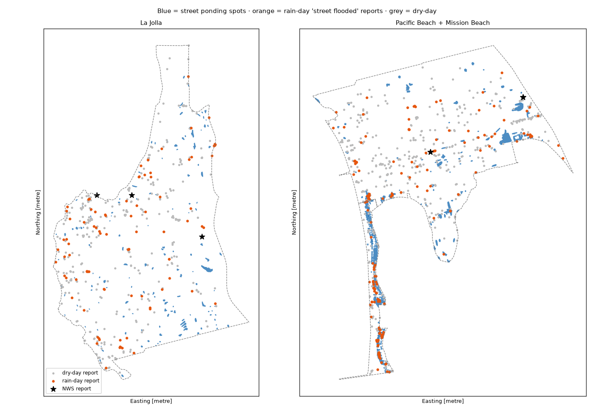

# Do flood reports land at our rain ponding spots?

_Written by `pipeline/check_ponds.py` on 2026-11-16. Reports: City of San Diego Get It Done (2017-2026) and NWS storm reports (2003-2026)._

**Fair test:** share of reports within 25 / 50 / 100 m of a street ponding spot, compared with random points on the same streets. *Lift* 2.0 = twice as often as chance. Dry-day reports (water mains, sprinklers) are a control: they should not cluster at rain spots.

| Group | Reports | ≤25 m | ≤50 m | ≤100 m | Lift at 50 m |
|---|---|---|---|---|---|
| Rain-day 'street flooded' reports | 271 | 46% | 48% | 59% | 3.1× |
| Dry-day 'street flooded' reports (control) | 895 | 16% | 24% | 40% | 1.5× |
| Rain-day storm-drain reports | 374 | 39% | 42% | 55% | 2.7× |
| NWS rain-flood reports (in the neighborhoods) | 8 | 0% | 0% | 38% | 0.0× |
| Random points on the same streets (chance) | 20000 | 9% | 16% | 32% | 1.0× |

## By neighborhood (rain-day 'street flooded', within 50 m)

| Neighborhood | Reports | Near a spot | Chance | Lift |
|---|---|---|---|---|
| La Jolla | 88 | 7% | 12% | 0.6× |
| Pacific Beach | 98 | 48% | 13% | 3.6× |
| Mission Beach | 85 | 92% | 82% | 1.1× |

## Spots with the most rain-day reports (within 50 m)

| Spot (streets) | Neighborhood | Reports | Different days |
|---|---|---|---|
| Bayside Lane / Mission Boulevard / San Gabriel Place | Mission Beach | 19 | 17 |
| Bayside Lane / Mission Boulevard / San Juan Place | Mission Beach | 17 | 13 |
| Mission Boulevard / Asbury Court / San Luis Rey Place | Mission Beach | 17 | 8 |
| Mission Boulevard | Mission Beach | 12 | 10 |
| Oliver Avenue / Reed Avenue | Pacific Beach | 11 | 7 |
| (unnamed) | Pacific Beach | 9 | 9 |
| Dawes Street / Pacific Beach Drive | Pacific Beach | 6 | 4 |
| Figueroa Boulevard | Pacific Beach | 6 | 3 |
| Mission Boulevard / San Gabriel Place | Mission Beach | 5 | 4 |
| Mission Boulevard / Pacific Beach Drive / Santa Rita Place | Mission Beach | 5 | 4 |
| San Fernando Place / Mission Boulevard | Mission Beach | 3 | 3 |
| (unnamed) | La Jolla | 2 | 2 |

## Reported rain flooding with no spot within 100 m (top clusters)

| Near (block) | Neighborhood | Reports | Days (first 3) |
|---|---|---|---|
| 700 block of Bonair St | La Jolla | 5 | 2020-11-08, 2020-12-28, 2023-01-01 |
| 7000 block of Country Club Dr | La Jolla | 3 | 2023-11-29, 2023-12-01, 2025-01-28 |
| 1500 block of Loring St | Pacific Beach | 3 | 2021-03-12, 2022-03-28, 2024-03-30 |
| 700 block of Emerald Ct | Pacific Beach | 3 | 2019-02-02, 2019-11-20, 2020-03-10 |
| 700 block of Midway St | La Jolla | 3 | 2019-12-27, 2025-03-07, 2025-03-13 |
| 1400 block of Chalcedony St | Pacific Beach | 3 | 2019-11-21, 2019-12-23, 2020-04-07 |
| 8500 block of Gilman Dr | La Jolla | 3 | 2019-02-14, 2023-03-11, 2023-03-21 |
| 5600 block of La Jolla Hermosa Av | La Jolla | 3 | 2025-02-14, 2025-12-25, 2026-11-01 |
| 1800 block of Malden St | Pacific Beach | 2 | 2024-01-22, 2024-02-02 |
| 700 block of Emerald St | Pacific Beach | 2 | 2020-03-10, 2020-03-12 |
| 1400 block of Grand Ave | Pacific Beach | 2 | 2019-02-05, 2019-11-20 |
| 2800 block of La Jolla Py | La Jolla | 2 | 2020-04-07, 2020-04-10 |

## NWS rain-flood reports in the neighborhoods

| When (UTC) | Where | Remark |
|---|---|---|
| 2007-02-19 18:59 | PACIFIC BEACH | HEAVY RAIN_ STREETS FILLED TO BRIM. |
| 2010-12-21 20:00 | LA JOLLA | MUDSLIDE/DEBRIS FLOW OCCURRED AT EL CAMINO DEL TEATRO AND MUIRLANDS DRIVE_ CLOSING THE ROADS. |
| 2014-03-01 00:20 | PACIFIC BEACH | NWS EMPLOYEE REPORTS 7 INCHES OF STANDING WATER AT THE INTERSECTION OF INGRAHAM STREET AND LA PLAYA AVENUE IN PACIFIC BEACH. |
| 2016-01-07 01:00 | 7 NNW SAN DIEGO | NORTHBOUND OFF RAMP FROM INTERSTATE 5 TO GRAND AVENUE IS CLOSED DUE TO SEVERE FLOODING. |
| 2016-01-07 02:00 | 8 S DEL MAR | SINKHOLE AT THE END OF AVENIDA DE LA PLAYA IN LA JOLLA. |
| 2019-11-28 19:12 | 3 ENE MISSION BEACH | ROADWAY FLOODING. |
| 2025-11-15 19:44 | 4 NNE Mission Beach | Roadway flooding reported on I5 S / Sr52 (La Jolla Pkwy). |
| 2026-01-01 15:36 | 3 ENE Mission Beach | Flooding under the bridge on I5-S/Garnet Ave along with a few soccer ball sized boulders. |

