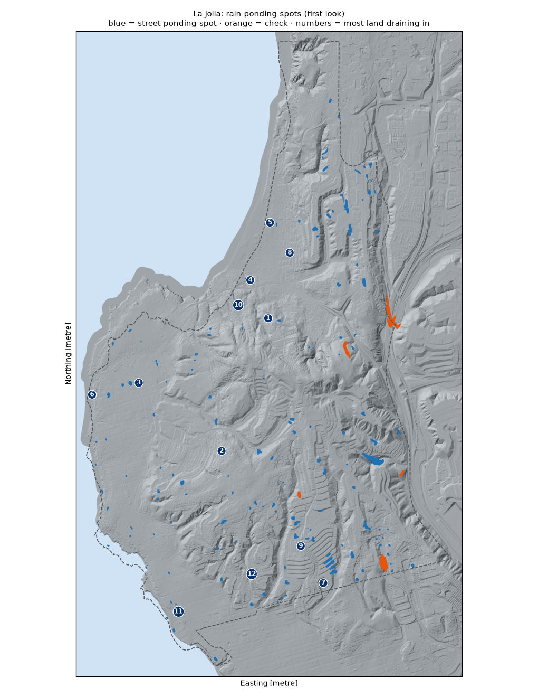
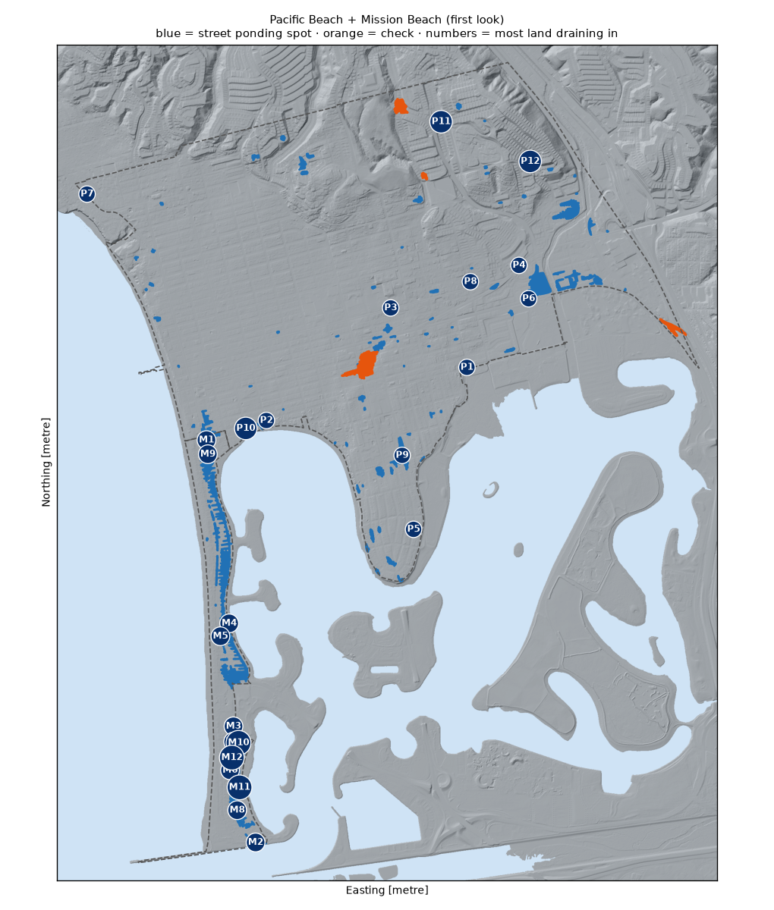

# Rain ponding spots: first look

_Written by `pipeline/plot_ponds.py` from `rain_terrain.py` + `rain_ponds.py` (2024 USGS lidar, OpenStreetMap streets). Not yet checked against flood reports._

Each spot is a dip where rain water collects on a public street or alley when storm drains can't keep up.
**Drains** = land whose rain flows straight into the spot, not through another dip first (bigger = more water arrives); in brackets, all land uphill (if every drain upstream fails). **Depth** = deepest water on the street when the dip is full. Numbers match the maps.

## La Jolla

| # | Street | Depth on street | Drains (all uphill) | Map |
|---|---|---|---|---|
| 1 | East Torrey Pines Road / Torrey Pines Lane | 18 in | 69 acres (442) | [map](https://www.openstreetmap.org/?mlat=32.85042&mlon=-117.25460#map=18/32.85042/-117.25460) |
| 2 | Nautilus Street | 32 in | 69 acres (260) | [map](https://www.openstreetmap.org/?mlat=32.83330&mlon=-117.26168#map=18/32.83330/-117.26168) |
| 3 | Fay Avenue | 6 in | 47 acres (684) | [map](https://www.openstreetmap.org/?mlat=32.84206&mlon=-117.27436#map=18/32.84206/-117.27436) |
| 4 | Vallecitos / Camino del Oro | 4 in | 41 acres (410) | [map](https://www.openstreetmap.org/?mlat=32.85534&mlon=-117.25735#map=18/32.85534/-117.25735) |
| 5 | El Paseo Grande | 5 in | 37 acres (86) | [map](https://www.openstreetmap.org/?mlat=32.86276&mlon=-117.25436#map=18/32.86276/-117.25436) |
| 6 | Coast Boulevard | 9 in | 35 acres (771) | [map](https://www.openstreetmap.org/?mlat=32.84052&mlon=-117.28151#map=18/32.84052/-117.28151) |
| 7 | Calle Vaquero | 37 in | 29 acres (34) | [map](https://www.openstreetmap.org/?mlat=32.81629&mlon=-117.24607#map=18/32.81629/-117.24607) |
| 8 | Calle del Cielo | 13 in | 29 acres (32) | [map](https://www.openstreetmap.org/?mlat=32.85888&mlon=-117.25133#map=18/32.85888/-117.25133) |
| 9 | Cardeno Drive | 24 in | 26 acres (59) | [map](https://www.openstreetmap.org/?mlat=32.82107&mlon=-117.24952#map=18/32.82107/-117.24952) |
| 10 | Paseo Dorado | 8 in | 26 acres (64) | [map](https://www.openstreetmap.org/?mlat=32.85211&mlon=-117.25918#map=18/32.85211/-117.25918) |
| 11 | Midway Street / La Jolla Boulevard | 14 in | 23 acres (203) | [map](https://www.openstreetmap.org/?mlat=32.81257&mlon=-117.26819#map=18/32.81257/-117.26819) |
| 12 | Vista Claridad | 10 in | 22 acres (29) | [map](https://www.openstreetmap.org/?mlat=32.81744&mlon=-117.25702#map=18/32.81744/-117.25702) |

Street spots: 153. Flagged to check (very deep on a street or a creek behind a road, usually a culvert the ground map cannot see): 6.

## Pacific Beach

| # | Street | Depth on street | Drains (all uphill) | Map |
|---|---|---|---|---|
| P1 | Pacific Beach Drive / Noyes Street | 10 in | 45 acres (173) | [map](https://www.openstreetmap.org/?mlat=32.79620&mlon=-117.23009#map=18/32.79620/-117.23009) |
| P2 | Dawes Street / Pacific Beach Drive | 30 in | 40 acres (78) | [map](https://www.openstreetmap.org/?mlat=32.79211&mlon=-117.24818#map=18/32.79211/-117.24818) |
| P3 | (unnamed street or alley) | 7 in | 37 acres (57) | [map](https://www.openstreetmap.org/?mlat=32.80072&mlon=-117.23699#map=18/32.80072/-117.23699) |
| P4 | Garnet Avenue | 8 in | 36 acres (512) | [map](https://www.openstreetmap.org/?mlat=32.80398&mlon=-117.22542#map=18/32.80398/-117.22542) |
| P5 | Jewell Street | 16 in | 25 acres (30) | [map](https://www.openstreetmap.org/?mlat=32.78384&mlon=-117.23488#map=18/32.78384/-117.23488) |
| P6 | Grand Avenue | 6 in | 18 acres (802) | [map](https://www.openstreetmap.org/?mlat=32.80144&mlon=-117.22454#map=18/32.80144/-117.22454) |
| P7 | Carla Way | 15 in | 18 acres (557) | [map](https://www.openstreetmap.org/?mlat=32.80934&mlon=-117.26441#map=18/32.80934/-117.26441) |
| P8 | (unnamed street or alley) | 5 in | 17 acres (32) | [map](https://www.openstreetmap.org/?mlat=32.80273&mlon=-117.22980#map=18/32.80273/-117.22980) |
| P9 | Jewell Street / La Playa Avenue / Yosemite Street | 30 in | 16 acres (80) | [map](https://www.openstreetmap.org/?mlat=32.78947&mlon=-117.23592#map=18/32.78947/-117.23592) |
| P10 | West Briarfield Drive / Pacific Beach Drive / Cass Street | 18 in | 15 acres (25) | [map](https://www.openstreetmap.org/?mlat=32.79150&mlon=-117.25004#map=18/32.79150/-117.25004) |
| P11 | Middleton Road | 20 in | 14 acres (57) | [map](https://www.openstreetmap.org/?mlat=32.81492&mlon=-117.23247#map=18/32.81492/-117.23247) |
| P12 | Loring Street | 39 in | 13 acres (31) | [map](https://www.openstreetmap.org/?mlat=32.81191&mlon=-117.22443#map=18/32.81191/-117.22443) |

Street spots: 93. Flagged to check (very deep on a street or a creek behind a road, usually a culvert the ground map cannot see): 4.

## Mission Beach

| # | Street | Depth on street | Drains (all uphill) | Map |
|---|---|---|---|---|
| M1 | Mission Boulevard / Pacific Beach Drive / Santa Rita Place | 23 in | 6 acres (1,045) | [map](https://www.openstreetmap.org/?mlat=32.79060&mlon=-117.25358#map=18/32.79060/-117.25358) |
| M2 | San Diego Place / North Jetty Road / Mission Boulevard | 24 in | 4 acres (12) | [map](https://www.openstreetmap.org/?mlat=32.75993&mlon=-117.24906#map=18/32.75993/-117.24906) |
| M3 | (unnamed street or alley) | 4 in | 3 acres (7) | [map](https://www.openstreetmap.org/?mlat=32.76879&mlon=-117.25108#map=18/32.76879/-117.25108) |
| M4 | Bayside Lane / Mission Boulevard / San Juan Place | 26 in | 2 acres (77) | [map](https://www.openstreetmap.org/?mlat=32.77663&mlon=-117.25149#map=18/32.77663/-117.25149) |
| M5 | Mission Boulevard | 13 in | 2 acres (10) | [map](https://www.openstreetmap.org/?mlat=32.77565&mlon=-117.25228#map=18/32.77565/-117.25228) |
| M6 | Mission Boulevard / San Gabriel Place | 14 in | 2 acres (23) | [map](https://www.openstreetmap.org/?mlat=32.76543&mlon=-117.25138#map=18/32.76543/-117.25138) |
| M7 | San Fernando Place / Mission Boulevard | 13 in | 2 acres (12) | [map](https://www.openstreetmap.org/?mlat=32.76762&mlon=-117.25110#map=18/32.76762/-117.25110) |
| M8 | Mission Boulevard / Asbury Court / San Luis Rey Place | 24 in | 1 acres (37) | [map](https://www.openstreetmap.org/?mlat=32.76239&mlon=-117.25073#map=18/32.76239/-117.25073) |
| M9 | Mission Boulevard | 6 in | 1 acres (9) | [map](https://www.openstreetmap.org/?mlat=32.78953&mlon=-117.25345#map=18/32.78953/-117.25345) |
| M10 | San Fernando Place / Mission Boulevard | 10 in | 1 acres (12) | [map](https://www.openstreetmap.org/?mlat=32.76752&mlon=-117.25062#map=18/32.76752/-117.25062) |
| M11 | Bayside Lane | 6 in | 1 acres (39) | [map](https://www.openstreetmap.org/?mlat=32.76413&mlon=-117.25052#map=18/32.76413/-117.25052) |
| M12 | Mission Boulevard | 6 in | 1 acres (15) | [map](https://www.openstreetmap.org/?mlat=32.76640&mlon=-117.25122#map=18/32.76640/-117.25122) |

Street spots: 42. Flagged to check (very deep on a street or a creek behind a road, usually a culvert the ground map cannot see): 0.

